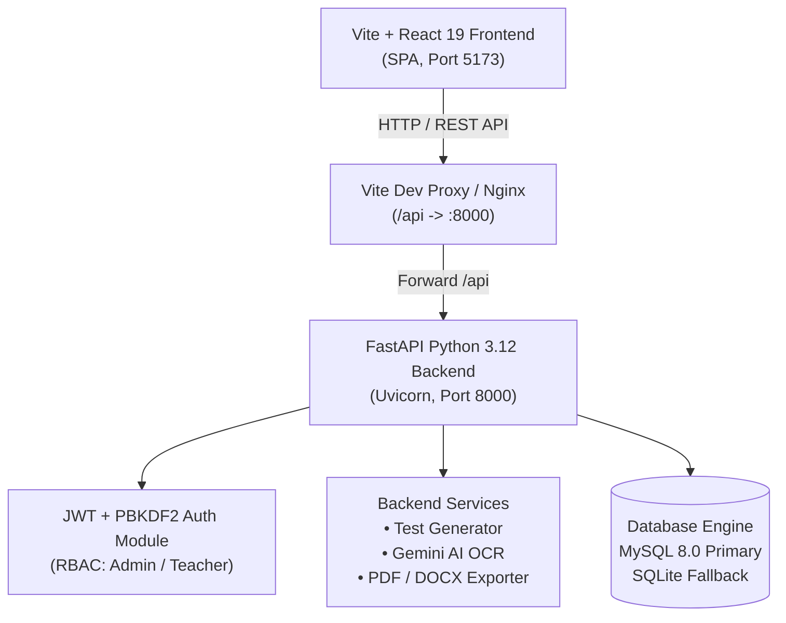

# The Century Academy — Automated Test Maker Portal


Official enterprise-grade Automated Test Maker and Assessment Management Platform developed for faculty and academic administrators of **The Century Academy of Science, Commerce & Arts** (Sargodha Road Campus, Faisalabad).

This platform streamlines syllabus management, textbook question extraction, board-pattern paper scheme drafting, automated test generation, and bilingual (English + Urdu) print and digital export (PDF & DOCX).

---

## 📋 Table of Contents
- [🌟 Key Capabilities & System Features](#-key-capabilities--system-features)
- [🏗️ System Architecture & Tech Stack](#️-system-architecture--tech-stack)
- [🔐 Role-Based Access Control (RBAC)](#-role-based-access-control-rbac)
- [🚀 Quick Start & Installation](#-quick-start--installation)
  - [Prerequisites](#prerequisites)
  - [Backend Setup (FastAPI + Python)](#backend-setup-fastapi--python)
  - [Frontend Setup (React + Vite)](#frontend-setup-react--vite)
  - [Database Seeding](#database-seeding)
- [🔑 Default User Accounts](#-default-user-accounts)
- [🏃 Running the Application](#-running-the-application)
- [🧪 Comprehensive Feature Test Checklist](#-comprehensive-feature-test-checklist)
  - [1. Authentication & Role-Based Access Control](#1-authentication--role-based-access-control)
  - [2. Textbook Upload & AI Extraction Pipeline](#2-textbook-upload--ai-extraction-pipeline)
  - [3. Question Review & Approval Bank](#3-question-review--approval-bank)
  - [4. Syllabus Division Manager](#4-syllabus-division-manager)
  - [5. Paper Scheme Management](#5-paper-scheme-management)
  - [6. Automated & Manual Test Generation](#6-automated--manual-test-generation)
  - [7. Physical Paper Customization & Formatting](#7-physical-paper-customization--formatting)
  - [8. Multi-Format Export (PDF, DOCX, Print)](#8-multi-format-export-pdf-docx-print)
  - [9. Automated Backend Unit Test Suite](#9-automated-backend-unit-test-suite)
- [🛡️ Security & Architecture Audit](#️-security--architecture-audit)
  - [Bugs Identified & Resolved](#bugs-identified--resolved)
  - [Security Hardening Measures Implemented](#security-hardening-measures-implemented)
  - [Future Enhancement Roadmap](#future-enhancement-roadmap)
- [🏫 Institution & Contact Information](#-institution--contact-information)

---

## 🌟 Key Capabilities & System Features

1. **Role-Based Access Control (RBAC)**:
   - **Academic Administrator**: Full control over textbook uploads, AI OCR extraction, question approvals/rejections, and syllabus schemas.
   - **Teacher**: Question drafting, automated test generation, manual question selection, live paper editing, and multi-format export.

2. **AI-Powered Textbook OCR & Extraction**:
   - Supports PDF textbooks and high-resolution page scans (PNG, JPG).
   - Integration with Google Gemini Vision AI for automated extraction of MCQs, Short Questions, Long Questions, and Theorems.
   - Fallback offline mock extractor ensures seamless development even without an active internet connection or Gemini API key.

3. **Academic Tree & Dynamic Syllabus Management**:
   - PCTB Punjab Board curriculum standard for Classes 9th, 10th, 11th, and 12th.
   - Subject coverage: Mathematics, Physics, Chemistry, Biology, and Computer Science.
   - Chapter division into Monthly Tests, First Term, Mid Term, Pre-Board, and Full Book.

4. **Board-Standard Paper Schemes**:
   - Configurable section rules (Section A: MCQs, Section B: Short Questions, Section C: Long Questions).
   - Total marks, choice allowances (e.g., "Attempt 6 out of 9"), question marks, and chapter distribution rules.
   - Pre-configured standard targets (15, 20, 25, 35, 50, 75 Marks).

5. **Dual Test Generation Engines**:
   - **Auto Generator**: Select Subject, Syllabus Division, and Scheme to instantly produce balanced, non-repetitive papers respecting difficulty mix and chapter weightages.
   - **Manual Question Picker**: Handpick questions item-by-item from the approved bank with real-time marks tally.

6. **Live Interactive Paper Editor**:
   - Swap any question with a single click without breaking the paper structure.
   - In-place question editing and marks overrides.
   - Add extra questions or delete questions on the fly.

7. **Bilingual Formatting & High-Contrast Typography**:
   - Clean Nastaliq typography for Urdu questions and standard serif/sans-serif for English.
   - Layout options: Bilingual (English + Urdu), English-Only, or Urdu-Only.
   - Paper-saving **2-Column Mode** designed to condense full test papers onto a single photocopy sheet.
   - Watermark toggle for official TCA academy branding.
   - Integrated Solution Marking Scheme / Answer Key generator.

8. **Multi-Format Export & Printing**:
   - **Direct Browser Print / Save PDF**: High-contrast, clean print styles optimized for photocopy toner reproduction.
   - **Microsoft Word Export (.docx / .doc)**: Fully editable Word document with academy letterhead, student info grid, and Principal signature block.
   - **Backend Vector PDF**: Clean vector rendering via Python ReportLab.

---

## 🏗️ System Architecture & Tech Stack



### Backend Components
- **Framework**: FastAPI (Python 3.12) with asynchronous ASGI support.
- **ORM**: SQLAlchemy 2.0 with connection pooling and automated SQLite fallback.
- **Security**: PBKDF2 HMAC-SHA256 password hashing (100,000 rounds) + RFC 7519 HS256 JWT tokens.
- **Document Processing**: `reportlab` (Vector PDF) and `python-docx` (OpenXML Word documents).
- **AI / OCR**: Google Gemini 1.5 Pro / Flash Vision API + PyMuPDF (`fitz`) for PDF rasterization.

### Frontend Components
- **Framework**: React 19 + Vite 6.
- **Styling**: Tailored Modern CSS Design System (clean dark-navy academy theme, glassmorphic accents, responsive layouts).
- **Icons**: Lucide React.
- **Mathematical Typography**: KaTeX formatting.

---

## 🔐 Role-Based Access Control (RBAC)

| Feature / Action | Academic Administrator | Teacher |
|:---|:---:|:---:|
| Upload Books & PDFs (Max 25MB) | ✅ Full Access | ❌ Restricted (403 Forbidden) |
| Trigger AI Extraction / Retry | ✅ Full Access | ❌ Restricted (403 Forbidden) |
| Approve / Reject Question Submissions | ✅ Full Access | ❌ Restricted (403 Forbidden) |
| Batch Approve Questions | ✅ Full Access | ❌ Restricted (403 Forbidden) |
| Delete Questions from Bank | ✅ Full Access | ❌ Restricted (403 Forbidden) |
| View Question Bank & Search | ✅ Full Access | ✅ Read-Only Review Mode |
| Create Question Draft | ✅ Created as Approved | ✅ Created as Pending Draft |
| Create Syllabus Divisions & Chapters | ✅ Full Access | ✅ Full Access |
| Create Paper Schemes (Max 15MB Upload) | ✅ Full Access | ✅ Full Access |
| Generate Test Papers (Auto / Manual) | ✅ Full Access | ✅ Full Access |
| Swap / Edit Questions on Live Paper | ✅ Full Access | ✅ Full Access |
| Export Word (.doc / .docx) & PDF | ✅ Full Access | ✅ Full Access |

---

## 🚀 Quick Start & Installation

### Prerequisites
- **Python**: Version 3.10, 3.11, or 3.12 installed ([python.org](https://www.python.org/downloads/)).
- **Node.js**: Version 18.0 or higher ([nodejs.org](https://nodejs.org/)).
- **MySQL Server** (Optional): If MySQL is not running, the system will **automatically fall back to a local SQLite database** (`backend/test_maker.db`) without any manual configuration.

---

### Backend Setup (FastAPI + Python)

1. Open your terminal in the project directory:
   ```bash
   cd d:\Automatic-Test-Maker-TCA
   ```

2. (Optional but recommended) Create and activate a Python virtual environment:
   ```bash
   # On Windows PowerShell:
   python -m venv venv
   .\venv\Scripts\Activate.ps1
   ```

3. Install backend dependencies:
   ```bash
   pip install -r backend/requirements.txt
   ```

4. Configure environment variables:
   Copy `.env.example` to `.env` in the root folder:
   ```bash
   cp .env.example .env
   ```
   Edit `.env` to configure your Gemini API Key or MySQL credentials if available:
   ```env
   # Database Configuration
   DB_HOST=localhost
   DB_PORT=3306
   DB_USER=u437839910_TCA_Test_Maker
   DB_NAME=u437839910_Test_Maker
   DB_PASS=TCATest786@

   # Google Gemini API Key for OCR & Textbook Extraction
   GEMINI_API_KEY=your_gemini_api_key_here

   # Security & JWT Tokens
   SECRET_KEY=tca-test-maker-secure-jwt-signing-key-2026-super-secret
   ACCESS_TOKEN_EXPIRE_MINUTES=1440
   ```

---

### Frontend Setup (React + Vite)

1. Install Node.js dependencies:
   ```bash
   npm install
   ```

2. Validate frontend production build:
   ```bash
   npm run build
   ```

---

### Database Seeding

Initialize the database schema and populate Punjab Board classes (9th–12th), subjects, 9th Mathematics chapters, sample board questions, syllabus divisions, paper schemes, and default users:

```bash
# To seed with MySQL (configured in .env):
python backend/seed.py

# OR to seed explicitly using offline SQLite:
python backend/seed.py --sqlite
```

---

## 🔑 Default User Accounts

The database comes pre-configured with two default accounts for immediate role testing:

| Role | Email Address | Default Password | Permissions |
|:---|:---|:---|:---|
| **Academic Administrator** | `admin@tca.edu.pk` | `Admin@123` | Full administrative authority (Book uploads, AI extraction, question approval/rejection). |
| **Teacher** | `teacher@tca.edu.pk` | `Teacher@123` | Academic faculty access (Test generation, drafting questions, live paper customization, multi-format export). |

> [!TIP]
> **1-Click Demo Login**: In the frontend application header, click the **User Role** badge or the **Login** button. The login modal provides instant 1-click buttons to sign in as either Admin or Teacher without typing credentials.

---

## 🏃 Running the Application

### 1. Start the FastAPI Backend
```bash
# From the project root:
uvicorn backend.app.main:app --host 127.0.0.1 --port 8000 --reload
```
The backend API and interactive OpenAPI documentation will be live at:
- **Interactive Swagger Docs**: [http://127.0.0.1:8000/docs](http://127.0.0.1:8000/docs)
- **ReDoc Documentation**: [http://127.0.0.1:8000/redoc](http://127.0.0.1:8000/redoc)
- **Health Check Endpoint**: [http://127.0.0.1:8000/api/v1/health](http://127.0.0.1:8000/api/v1/health)

### 2. Start the Vite Frontend Dev Server
In a separate terminal window:
```bash
npm run dev
```
Open your browser at **[http://localhost:5173](http://localhost:5173)**. The Vite dev server automatically proxies `/api` calls to the FastAPI backend at `http://127.0.0.1:8000`.

---

## 🧪 Comprehensive Feature Test Checklist

Use this systematic test checklist to verify every feature of the application:

### 1. Authentication & Role-Based Access Control
- [ ] **Admin Login**: Open the login modal, select "Admin Role" or enter `admin@tca.edu.pk` / `Admin@123`. Verify the purple **ADMIN** badge appears in the top navigation bar.
- [ ] **Teacher Login**: Click the role switcher or enter `teacher@tca.edu.pk` / `Teacher@123`. Verify the emerald **TEACHER** badge appears in the navigation bar.
- [ ] **Role Protection on Book Upload**:
  - Switch to Teacher mode. Navigate to the **"Upload Books"** tab.
  - Verify the **"Admin Privileges Required"** banner is displayed and the upload dropzone is disabled.
- [ ] **Role Protection on Question Review**:
  - In Teacher mode, navigate to the **"Review Questions"** tab.
  - Verify the **"Teacher View (Read-Only Review Mode)"** banner is displayed.
  - Verify the "Approve", "Reject", and "Batch Approve" buttons are disabled.
- [ ] **Admin Authority**: Switch back to Admin mode. Verify full upload and question approval capabilities are immediately unlocked.

### 2. Textbook Upload & AI Extraction Pipeline
- [ ] **File Type Validation**: Attempt to upload a `.exe` or `.zip` file. Verify the system rejects the file with an `Unsupported file format` message.
- [ ] **File Size Limit (25MB)**: Attempt to upload a file exceeding 25MB. Verify an HTTP 413 `File exceeds maximum allowed size of 25MB` error is returned.
- [ ] **Valid Book Upload**: Upload a valid PDF or textbook image (`.pdf`, `.png`, `.jpg` under 25MB).
- [ ] **Extraction Status Polling**: Verify the upload shows status `queued` -> `processing` -> `completed`.
- [ ] **Extracted Questions Generation**: Verify newly extracted questions appear in the question review queue.

### 3. Question Review & Approval Bank
- [ ] **Filter by Status**: Filter questions by `Pending`, `Approved`, and `Rejected`.
- [ ] **Filter by Academic Hierarchy**: Filter questions by Class (9th), Subject (Mathematics), and Chapter.
- [ ] **Individual Approval**: As Admin, click "Approve" on a pending question. Verify its status badge changes to `Approved`.
- [ ] **Individual Rejection**: As Admin, click "Reject" on a pending question. Verify its status changes to `Rejected`.
- [ ] **Batch Approval**: Select multiple checkboxes and click "Batch Approve Selected". Verify all selected questions update simultaneously.
- [ ] **Draft Question Creation**: In Teacher mode, click "Add New Question", fill out the form, and submit. Verify it is saved with `status="draft"` (teachers cannot self-approve questions).

### 4. Syllabus Division Manager
- [ ] **Navigate to Schemes & Syllabus**: Switch to the "Schemes & Syllabus" tab.
- [ ] **Create Syllabus Division**: Create a division (e.g., "First Term Test - Chapters 1 to 3").
- [ ] **Assign Chapters & Weightages**: Check Chapters 1, 2, and 3 and assign weightage percentages (e.g., 30%, 40%, 30%).
- [ ] **Save & Verify**: Save the syllabus division and confirm it appears in the dropdown on the Test Generator wizard.

### 5. Paper Scheme Management
- [ ] **Scheme File Size Limit (15MB)**: Test upload of a paper scheme syllabus document exceeding 15MB. Verify an HTTP 413 error is returned.
- [ ] **Create Board Scheme**: Configure a scheme with Section A (5 MCQs, 5 Marks), Section B (8 Shorts, attempt 6, 12 Marks), and Section C (2 Longs, attempt 1, 8 Marks). Total: 25 Marks.
- [ ] **Input Validation**: Attempt to save a section with "Number to Attempt" greater than "Total Questions". Verify validation blocks submission.

### 6. Automated & Manual Test Generation
- [ ] **Automated Generation**:
  - In the "Generator" tab, select Class `9th`, Subject `Mathematics`.
  - Select target marks (e.g., `25 Marks` or `50 Marks`).
  - Click **"⚡ Auto Generate Paper"**.
  - Verify a balanced test is generated containing approved questions only.
- [ ] **Manual Generation**:
  - Switch to the "Manual Question Picker" mode.
  - Handpick 5 MCQs, 3 Short Questions, and 1 Long Question.
  - Verify the live marks tally updates in real time.
  - Click "Generate Custom Paper" and verify the paper renders.
- [ ] **Shortage Handling**: Select a chapter that has zero approved questions. Verify the generator returns a descriptive shortage notice without crashing.

### 7. Physical Paper Customization & Formatting
- [ ] **Question Swap**: Click the "Swap" icon next to any question on the live paper. Verify a modal appears with alternative questions from the same chapter/topic, and selecting one swaps it seamlessly.
- [ ] **In-Place Question Edit**: Click the "Edit" icon on any question, edit the wording or Urdu translation, and save. Verify the update reflects instantly.
- [ ] **Question Deletion**: Click the "Delete" icon on any question. Verify the section numbers adjust automatically.
- [ ] **2-Column Mode (Paper Saver)**: Click the "2-Column" toggle button in the toolbar. Verify the layout splits into two compact columns designed to fit on one physical sheet.
- [ ] **Language Modes**:
  - Select **Bilingual (English + Urdu)**: Verify both English text and Nastaliq Urdu render side-by-side.
  - Select **English Only**: Verify Urdu text is hidden.
  - Select **Urdu Only (اردو)**: Verify English text is hidden and alignment shifts right-to-left.
- [ ] **Answer Key Toggle**: Click the "Answer Key" toggle. Verify the full marking scheme and correct MCQ options render at the bottom.

### 8. Multi-Format Export (PDF, DOCX, Print)
- [ ] **Browser Print / Save PDF**: Click **"Print / Save PDF"**. Verify print preview opens cleanly with page headers, student details table, and no website UI elements (clean `@media print` rules).
- [ ] **Client-Side Word Export (.doc)**: Click **"Export to Word (.doc)"**. Verify a `.doc` file downloads with official TCA letterhead and opens in Microsoft Word.
- [ ] **Backend PDF Generation**: Trigger `/api/v1/tests/export/pdf`. Verify a vector PDF document downloads with embedded fonts.
- [ ] **Backend DOCX Generation**: Trigger `/api/v1/tests/export/docx`. Verify a native `.docx` document downloads with formatted tables.

### 9. Automated Backend Unit Test Suite
Run the comprehensive automated test suite covering all backend services, authentication, role restrictions, file limits, and exporters:
```bash
python -m unittest discover backend/tests
```
**Expected Result**: All 48 test cases pass cleanly with `OK`.

---

## 🛡️ Security & Architecture Audit

A complete security and codebase audit was conducted across the backend and frontend. Below is the structured audit report:

### Bugs Identified & Resolved
1. **Model Column Naming Inconsistency (`GeneratedTestQuestion`)**:
   - *Issue*: Code in `backend/app/services/test_exporter.py` referenced `question_rel.order_index`, but the database column in `test_paper.py` is named `order`.
   - *Fix*: Aligned all export queries and test fixtures to use `order`, preventing runtime attribute errors.
2. **Starlette Deprecation Warning on 413 Status Code**:
   - *Issue*: `status.HTTP_413_REQUEST_ENTITY_TOO_LARGE` triggered deprecation notices in newer Starlette/FastAPI versions.
   - *Fix*: Replaced with standard status code `413` across `books.py` and `schemes.py`.
3. **Database Seeding User Missing from Direct CLI Invocation**:
   - *Issue*: Seeding via `backend/seed.py` populated classes and questions but did not seed user accounts unless launched through FastAPI `init_db()`.
   - *Fix*: Integrated `seed_default_users(db)` into `backend/seed.py`, ensuring both Admin and Teacher accounts exist regardless of seed method.
4. **Teacher Self-Approval Privilege Escalation**:
   - *Issue*: Creating questions via API allowed passing arbitrary `status="approved"`.
   - *Fix*: Added server-side enforcement forcing `status="draft"` whenever non-admin users submit questions.

---

### Security Hardening Measures Implemented
- **Cryptographic Password Hashing**: PBKDF2 HMAC-SHA256 with 100,000 iterations and a 16-byte random salt per user. Timing-attack resistant verification via `secrets.compare_digest`.
- **Stateless RFC 7519 HS256 JWT Tokens**: Tokens carry user `sub` (ID), `email`, and `role`. Tokens expire after 24 hours (`ACCESS_TOKEN_EXPIRE_MINUTES`).
- **Path Traversal Protection**: Uploaded filenames are sanitized using `Path(file.filename).name` and stored with unique UUID prefixes, preventing arbitrary file overwrite attacks.
- **Streaming Upload Size Limits**: Uploads are read in 1MB chunks and abort immediately upon exceeding the limit (25MB for books, 15MB for schemes), deleting partial temp files from disk to prevent DoS attacks.
- **Strict File Type Whitelisting**: Dual-layer verification of both file extensions (`.pdf`, `.png`, `.jpg`, `.jpeg`) and MIME types.
- **SQL Injection Prevention**: 100% parameterized queries via SQLAlchemy 2.0 ORM.
- **Centralized Error Handling**: FastAPI exception handlers for `StarletteHTTPException` and `RequestValidationError` catch all validation and HTTP errors, returning clean JSON without leaking stack traces.

---

### Future Enhancement Roadmap
1. **Token Revocation / Blacklist**: Implement a Redis-backed token revocation list for instantaneous logout and session invalidation across devices.
2. **Rate Limiting**: Add `slowapi` or Redis-based rate limiting to `/api/v1/auth/login` to prevent credential brute-force attacks (e.g., max 5 attempts per minute per IP).
3. **Production CORS Lockdown**: In `backend/app/config.py`, replace development wildcard origins (`"*"`) with the explicit production domain (e.g., `https://tests.tca.edu.pk`).
4. **Celery / Redis Background Tasks**: Migrate asynchronous book extraction tasks from in-memory dictionary storage to Celery with Redis for persistence across server restarts.
5. **OMR Sheet Generator**: Automated generation of printable bubble sheets matching test paper MCQ keys for automated optical grading.
6. **Visual Math Equation Editor**: Integrated LaTeX equation editor toolbar in the question draft modal for mathematics and physics faculty.

---

## 🏫 Institution & Contact Information

**The Century Academy of Science, Commerce & Arts**  
*Sargodha Road Campus, Faisalabad, Punjab, Pakistan*  
- **Director / Principal**: Syed Faraz Hassan  
- **Official Contact**: +92 313 8272600  
- **System Architecture**: FastAPI (Python 3.12) + React 19 (Vite) + MySQL 8.0 / SQLite  
- **Motto**: *"Where Fine Arts & Tech Skills Meet Academic Excellence"*
